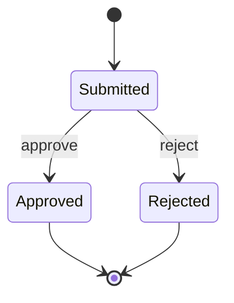

# Claims Workflow API
### A focused C# / ASP.NET Core portfolio demonstration

A small API showing how a claim moves from submission to a final decision, with explicit input validation, predictable HTTP responses, concurrency protection, integration tests, and GitHub Actions CI.

**Independent sample:** created for this portfolio with synthetic data. It is not employer software, a real claims-adjudication system, or a deployed production service.

## Run locally
Requires the .NET 8 SDK.

```sh
dotnet run --project src/Claims.Api --urls http://localhost:5080
```

```sh
curl http://localhost:5080/health
curl -i http://localhost:5080/api/claims -H 'Content-Type: application/json' -d '{"reference":"DEMO-001","amount":125.50}'
# Copy the returned id into the URL below:
curl -i http://localhost:5080/api/claims/REPLACE_WITH_ID/decision -H 'Content-Type: application/json' -d '{"outcome":"approve"}'
```

## API contract
| Endpoint | Behavior |
|---|---|
| GET /health | Process health; 200 |
| GET /api/claims | List in-memory claims; 200 |
| GET /api/claims/{id} | Read a claim; 200 or 404 |
| POST /api/claims | Create; 201 with Location, or 400 |
| POST /api/claims/{id}/decision | Approve/reject; 200, 400, 404, or 409 |

References contain 1–64 characters. Amounts are positive, at most 1,000,000, with at most two decimal places. Decisions accept `approve` or `reject`. A final decision cannot be changed.



## Design decisions
- Immutable records make each state transition explicit.
- A concurrent dictionary supports safe reads; a lock makes the read/check/update decision atomic within one process.
- Validation errors use Problem Details; final-state conflicts return HTTP 409.
- Integration tests exercise HTTP contracts and persisted in-process state, rather than only testing helper methods.
- Small scope keeps the business rules and tradeoffs easy to review.

## Verify
```sh
dotnet test tests/Claims.Tests/Claims.Tests.csproj --configuration Release
```
GitHub Actions runs the same command on pushes and pull requests. No successful CI run is claimed until execution succeeds.

## Boundaries and next steps
This local demo has no authentication, authorization, database, durable audit log, pagination, or deployment. Data disappears on restart. Use synthetic identifiers only; do not enter patient or financial information. Keep it bound to localhost.

A production evolution would add authenticated roles, persistent storage with optimistic concurrency, decision audit events, idempotency, pagination, tracing, and secret management. Azure hosting and an Angular review UI are possible future extensions, not implemented features.

Prepared with AI assistance for Chaitanya Kurumella's portfolio. Review and extend it before presenting it as personal implementation experience.
