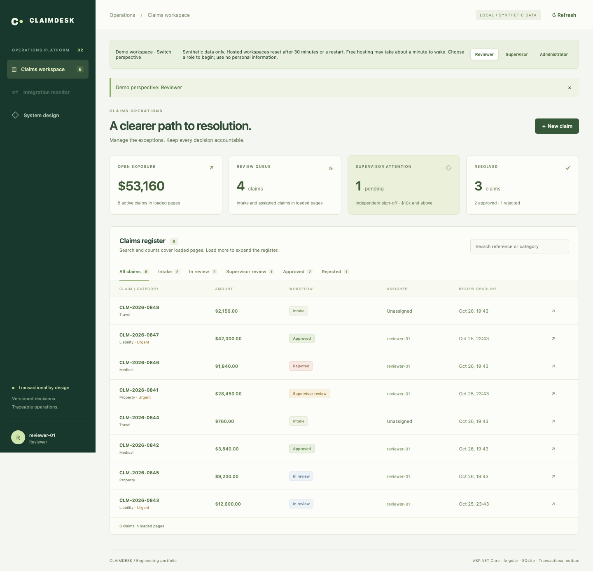
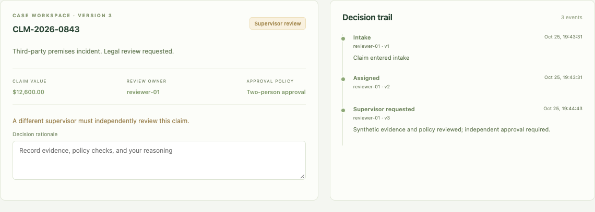
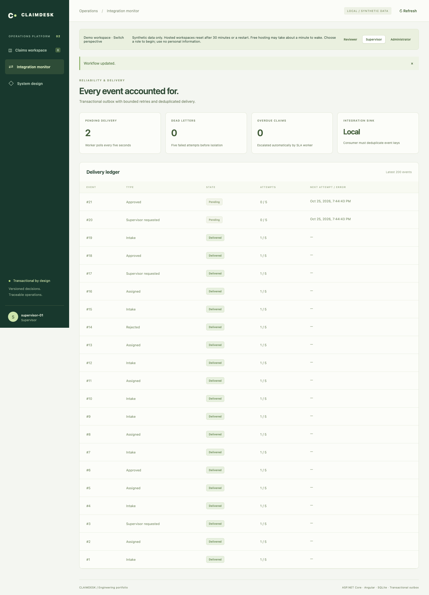
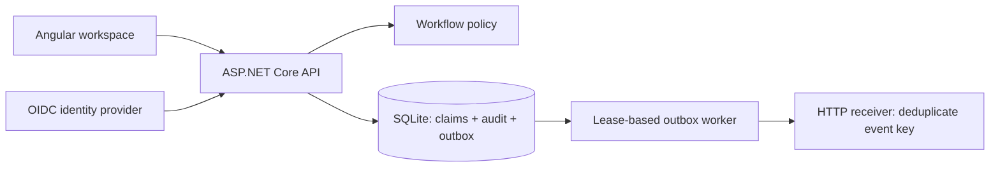

# ClaimDesk — claims workflow and delivery

ASP.NET Core 10, Angular 20 and SQLite. A claims operations application demonstrating independent approval, transactional audit/outbox writes, schema evolution, personal token identities and recoverable HTTP delivery.

Independent portfolio project built with AI assistance and synthetic data. This repository shows implementation and reproducible evidence; it does not claim employer ownership, production usage or production scale.

## Evaluate in five minutes

- [Published demo release](https://github.com/ChaitanyaKurumella/claims-workflow-api/releases/tag/v0.3.0-demo)
- [Build and verification history](https://github.com/ChaitanyaKurumella/claims-workflow-api/actions)
- [Three-minute walkthrough](docs/walkthrough.md)
- [Zero-cost hosting readiness and limits](docs/free-hosting.md)

[Open the live interactive demo](https://claims-workflow-api.onrender.com/). Choose Reviewer to start an isolated synthetic workspace, then switch to Supervisor for independent approval. Workspaces expire after 30 minutes and reset on restart. Free hosting can take about a minute to wake. Use synthetic data only. See [deployment verification](docs/public-demo-verification.md) for tested behavior and limits.

## See the workflow



1. Choose **Reviewer**, open `CLM-2026-0843` ($12,600), enter a rationale, and request supervisor sign-off.
2. Switch to **Supervisor**, review the claim and audit trail, enter an independent rationale, and approve.
3. Open **Integration monitor** to inspect the outbox delivery record. See the [three-minute walkthrough](docs/walkthrough.md) for details.





Screenshots show the local synthetic demo. Visitor workspaces expire after 30 minutes or reset on restart; reconnect with a demo role to begin again. Expired sessions clear the register, selected claim and audit history. A missing selected claim is dismissed while the refreshed register remains available.



The claim change, audit record and outbox event commit in one transaction. HTTP delivery happens afterward, with retries and receiver deduplication.

## Run locally

Requires .NET 10 SDK, Node.js 22.12+, npm, Python 3 for operational exercises, and OpenSSL for generated demo keys.

```sh
bash scripts/run-demo.sh
```

Open http://localhost:5081. Choose Reviewer, select `CLM-2026-0843`, record a rationale and request supervisor sign-off. Switch to Supervisor for the independent final decision. Inspect the audit trail and integration monitor. Demo mode and synthetic data must remain on loopback.

## Engineering evidence

| Concern | Implementation and evidence |
|---|---|
| Business rules | Pure `WorkflowPolicy`, evaluated inside the claim transaction; assignments, rationale, independent second approval and immutable final decisions |
| Atomicity and concurrency | Claim, audit and outbox commit together; injected write failure rolls all three back; eight concurrent stores produce one decision |
| Storage evolution | Three ordered transactional migrations; legacy JSON claims become relational rows with integer cents and constraints; preservation, rollback and future-version tests |
| Bounded work | Keyset pages, status/id index, indexed SLA batches of 100; query plans retained in `docs/evidence` |
| Delivery failure | Separate outbox persistence and HTTP adapter; 30s leases, fencing tokens, stable event keys, bounded retries, dead letters and recovery |
| Personal identities | Standard JWT bearer validation against OIDC authority/audience; role mapping fails closed; issuer, audience, expiry and signature tests |
| Browser regression | Real API and production Angular bundle; independent sessions, stale-version conflicts, recovery, HTML reports and failure traces in CI |
| Frontend boundaries | Typed API transport and models, case workspace and integration monitor components, separate templates, policy and transport tests |
| Request diagnostics | W3C trace correlation, response/problem IDs, final-status completion logs and bounded route metrics; [triage guide](docs/request-observability.md) |
| Operational recovery | SQLite online backup tool and restore test preserve claims, audit, outbox and event identity |
| Measured behavior | Reproducible local read probe and real HTTP acknowledgement-gap exercise; raw results and limitations included |

48 backend test cases and six browser workflow scenarios were verified locally for request diagnostics. Nine frontend unit tests are also included. Angular production build and application publish were verified for the browser-suite release. Check the GitHub Actions run for the status of the published revision.

## Verify

```sh
dotnet test tests/Claims.Tests/Claims.Tests.csproj --configuration Release
(cd web && npm ci && npm test && npm run build)
```

CI runs backend and frontend unit tests, builds and packages the application, then starts the real API for six Playwright browser scenarios. These cover independent approval, API role enforcement, visitor isolation, delivery recovery, session loss and conflicting decisions in two tabs. HTML reports and failure traces are retained for 14 days. See the [browser test guide](docs/browser-tests.md) for local commands, coverage and limits.

## API

Authenticated requests use `X-Api-Key` in service/demo mode, or `Authorization: Bearer ...` in OIDC mode. The UI accepts a token prefixed with `Bearer ` and keeps it only in memory.

| Route | Behavior |
|---|---|
| GET `/health` | Database connection and schema readiness |
| GET `/api/session` | Server-derived actor and role |
| GET `/api/claims/page?limit=50&status=InReview&after=<id>` | Up to 100 items, opaque-to-client `nextCursor`; status optional |
| GET `/api/claims` | Compatibility view, bounded to 100 claims |
| GET `/api/claims/{id}` | Current claim/version |
| GET `/api/claims/{id}/history` | Actor-attributed audit history |
| POST `/api/claims` | Intake with actor-scoped `Idempotency-Key` of 8–128 characters |
| POST `/api/claims/{id}/{assign,release,approve,reject}` | Versioned workflow command |
| GET `/api/operations` | Aggregate totals and latest 200 delivery records; supervisor/admin only |
| POST `/api/operations/outbox/{id}/retry` | Reset a dead letter for replay; supervisor/admin only |

Commands carry `{"version":2,"note":"Evidence checked"}`. A conflict requires a fresh review. Intake retries must reuse the same key and payload. UI register filters, counts and exposure apply to loaded pages; the operations summary is computed across the database.

## Read the decisions and limits

- [Architecture and tradeoffs](docs/architecture.md)
- [Identity, integrations, backup and operational exercises](docs/operations.md)
- [Verification and measured results](docs/verification.md)
- [Decision records](docs/decisions.md)

SQLite remains a single-host writer architecture. Delivery is at least once and requires a deduplicating consumer. OIDC support is implemented and tested with signed local fixtures; no real identity tenant is provisioned. Logs and .NET meters exist, but telemetry export, dashboards, alerting and deployment SLOs remain deployment work. This is a stronger engineering sample, not a production certification.

### Integration monitor walkthrough

Sign in as Supervisor or Administrator and open Integration monitor. Filter the latest 200 events by delivery state or search event IDs, claim IDs, event types and errors. Select an event to inspect its payload, current attempt cycle and last error. Use Refresh to update delivery state.

In public demo mode, **Simulate downstream failure** creates one synthetic event in the current visitor workspace. Five accelerated failures exercise the local delivery failure path and produce a dead letter without contacting an external endpoint. Select **Retry delivery**, then inspect its Delivered state. Retry resets the attempt cycle; delivered events cannot be retried. Each visitor has an isolated local sink; the simulation endpoint is unavailable outside public demo mode.

## Telemetry showcase

Opt-in OTLP traces and metrics, with a local dashboard: [run and investigate](docs/telemetry-dashboard.md). Export is disabled by default.
