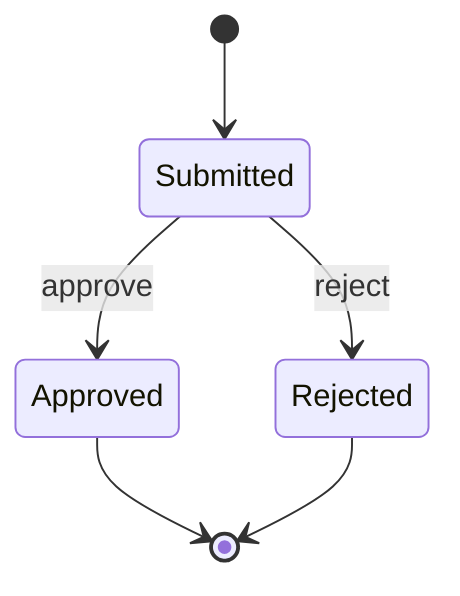

# Claims Workflow · Engineering Showcase

[](https://github.com/ChaitanyaKurumella/claims-workflow-api/actions/workflows/ci.yml)

**C# / ASP.NET Core · Angular · Durable workflow · Automated verification**

A review workspace that takes a synthetic claim from submission to a final decision, with durable state, an event history, and explicit conflict handling.

> Independent portfolio demo prepared with AI assistance. Uses synthetic data. This is not employer software, a production deployment, or evidence that this system was used at work.

## Explore the implementation

| Capability | Evidence |
|---|---|
| Workflow and input rules | [Domain](src/Claims.Api/Domain.cs) · [HTTP endpoints](src/Claims.Api/Program.cs) |
| Durable state and atomic decisions | [Store](src/Claims.Api/Store.cs) |
| Angular review dashboard | [UI](web/src/main.ts) · [styles](web/src/styles.css) |
| API, restart, concurrency and access tests | [Tests](tests/Claims.Tests) |
| Architecture and production tradeoffs | [Design notes](docs/architecture.md) |
| Deployment and security boundaries | [Operations guide](docs/operations.md) |

## Run the complete workspace

Requires .NET 8 SDK and Node.js 22.12+.

```sh
cd web
npm ci
npm run build
cd ..
mkdir -p src/Claims.Api/wwwroot
cp -R web/dist/dashboard/browser/. src/Claims.Api/wwwroot/
# Generate a local secret. Keep the terminal open; do not commit the value.
export Claims__ApiKey="$(openssl rand -hex 32)"
printf '%s\n' "$Claims__ApiKey"
dotnet run --project src/Claims.Api --urls http://localhost:5080
```

Open **http://localhost:5080**, enter the generated local API key, and select **Connect & refresh**. The key stays in the current Angular component's memory; refreshing clears it. Use synthetic references such as `DEMO-001`.

1. Submit a claim with an amount such as `125.50`.
2. Approve or reject it in the review queue.
3. Select its reference to inspect the timestamped event history.
4. Restart the API and reconnect: the claim and history remain on disk.

The server also runs without the UI build. API examples:

```sh
curl http://localhost:5080/health
curl http://localhost:5080/api/claims -H "X-Api-Key: $Claims__ApiKey"
curl -i http://localhost:5080/api/claims -H "X-Api-Key: $Claims__ApiKey" \
  -H 'Content-Type: application/json' -d '{"reference":"DEMO-001","amount":125.50}'
```

## API contract

All `/api` routes require `X-Api-Key`. `/health` is public.

| Route | Result |
|---|---|
| GET /api/claims | All claims, ordered by reference |
| GET /api/claims/{id} | Claim, or 404 |
| GET /api/claims/{id}/history | Timestamped events, or 404 |
| POST /api/claims | 201 + Location; 400 invalid input; 409 duplicate reference |
| POST /api/claims/{id}/decision | 200; 400 invalid outcome; 404 missing; 409 already final |

References contain 1–64 characters and are unique ignoring case after trimming. Amounts must be positive, at most 1,000,000, with at most two decimal places. Decisions accept `approve` or `reject`.



## Verify

```sh
dotnet test tests/Claims.Tests/Claims.Tests.csproj --configuration Release
cd web && npm ci && npm run build
```

GitHub Actions builds the dashboard, runs the backend integration tests, and creates a downloadable application bundle. Read the linked workflow for the current result.

## Scope

Storage is a JSON file with serialized writes and same-directory replacement. It supports **one server process**, modest synthetic datasets, and local demonstration. The shared API key is a local access gate, not user identity or role-based authorization. Audit entries record system actions, not verified human actors. This demo has no pagination, database transactions, multi-instance coordination, backups, or public cloud deployment. See the design notes before extending it.
