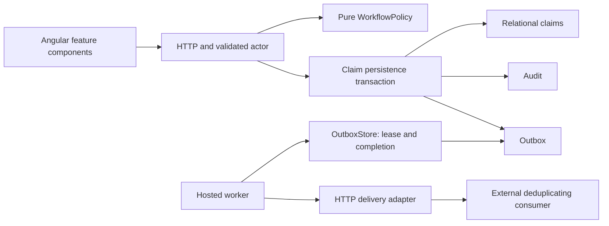
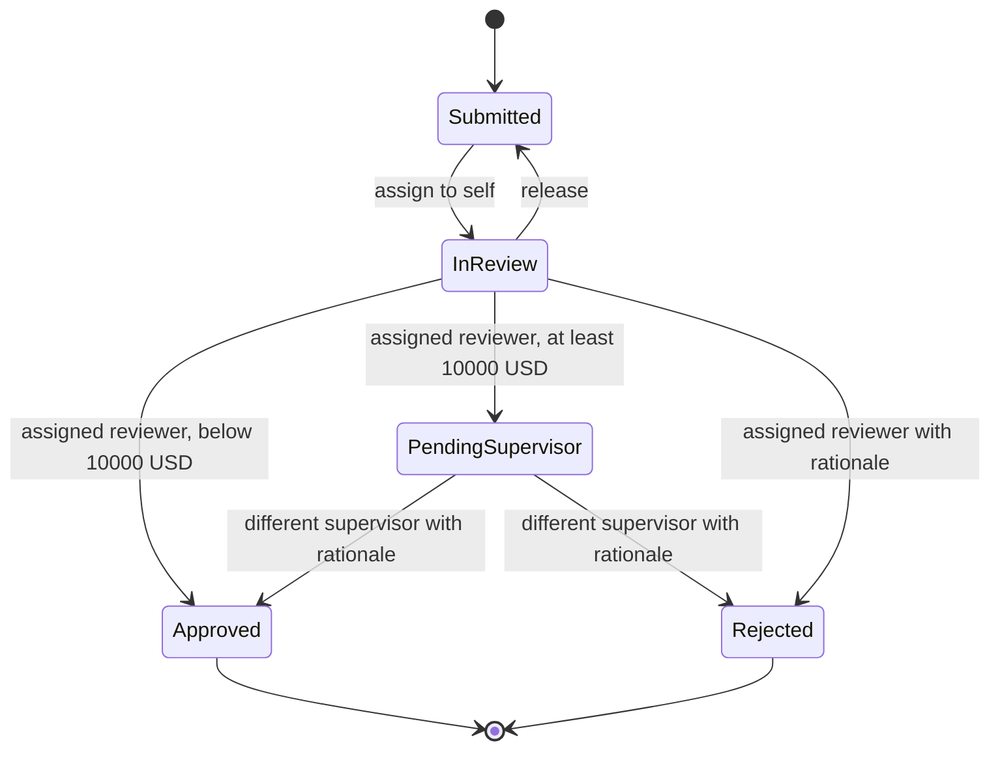

# Architecture

ClaimDesk is a single deployable API/worker with an Angular client and a local SQLite database. Its consistency boundary is one claim mutation, its audit record and its outbox entry.

## Boundaries

`WorkflowPolicy` contains transitions and authorization, without storage, HTTP or time dependencies. `Store` owns claim persistence and the atomic audit/outbox write. `OutboxStore` owns leasing, retry and delivery persistence. `SqliteDatabase` centralizes connections and parameterized commands. `SchemaMigrator` owns ordered upgrades. `HttpEventDelivery` performs network I/O; `OutboxDispatcher` coordinates it without holding a database transaction. `OperationsWorker` schedules bounded delivery and SLA work.

The Angular bootstrap imports the application component. Models and HTTP transport are independent modules; the case workspace and integration monitor have their own components/templates. The application component still coordinates intake, register loading and sessions; further splitting should follow feature growth. UI policy is a convenience; the server remains authoritative.

## Workflow

Supervisors can release another person's assignment. They cannot decide an InReview claim assigned to someone else. Any actor who performed the initial review is barred from the second approval, including administrators. Final decisions are immutable.

## Persistence and migrations

Migration 1 retains the original schema. Migration 2 converts JSON claim documents to relational columns, integer cents, status/version constraints and query indexes, preserving audit/outbox IDs and relationships. Audit/outbox payloads remain immutable JSON event snapshots. Migration 3 adds leases and a persistent database identity used to namespace event keys. Each upgrade and its version record commit in one transaction. Unknown future schemas fail startup. A corrupt legacy claim aborts the migration and retains the old schema/data. Tests exercise upgrades with existing child rows and `foreign_key_check`.

Back up before upgrading. There is no automated downgrade: restore the verified backup with the matching prior application version. Migrations can hold SQLite's write lock and rebuild tables; large production databases need a separately planned maintenance window.

SQLite immediate write transactions serialize writers, protecting the version check and mutation. This is not a server-database row-version implementation. SQL parameters protect query inputs; unique references are case insensitive. Actor-scoped idempotency retains the original intake response and rejects changed payloads under the same key.

Pages use UUID keyset ordering, not creation time. Their cursor is a last-seen ID, with at most 100 API rows. They are live views, not snapshot exports: concurrent inserts before the cursor may appear only after refresh. Filters and summary counts in the register cover loaded pages. Operations totals use database aggregates. History and idempotency retention remain unbounded; those policies require domain decisions.

SLA queries use a partial due-date index and process at most 100 overdue active claims per worker cycle. Escalation increments the version and records an audit/outbox entry exactly once per claim. It intentionally invalidates stale reviewer commands.

## External delivery and crash windows

A lease transaction selects one due event, increments its attempts, assigns a random fencing token and expires after 30 seconds. HTTP has a 10-second timeout and follows no redirects. Network I/O happens after the transaction commits. A 2xx response is acknowledged using the same fencing token. A stale worker cannot acknowledge a newer lease. Failures back off exponentially; five attempts dead-letter. A crash on the fifth attempt also becomes a dead letter after lease expiry.

Event identity is `<persistent-database-id>:<outbox-id>` and survives backups. A receiver can commit successfully while its response or the sender's acknowledgement is lost. The sender will replay that event. Consumers must deduplicate by event key in the same transaction as their business side effects. The included receiver demonstrates durable deduplication across a real 503/retry boundary. Delivery is at least once; global or per-claim ordering across multiple workers is not guaranteed. Retrying a dead letter retains its event identity.

With no DeliveryUrl, the original local receipt sink is used. It atomically stores receipt and delivery status in the same database and does not exercise a network boundary. External mode uses leases; do not switch modes while events are leased without allowing recovery. Outbox monitoring is bounded to the latest 200 events; totals include the full queue.

## Identity and operation boundaries

OIDC mode uses the standard ASP.NET JWT bearer handler, HTTPS discovery, signature/issuer/audience/expiry validation, `sub` as actor ID and exactly one recognized `roles` claim. Missing or ambiguous recognized roles fail closed. Identity provisioning and correct role claims belong to the operator. OIDC mode refuses simultaneous demo sessions or service keys. Signed local token fixtures test acceptance and rejection; a real provider has not been connected.

Demo/service mode uses fixed server-derived actors. Demo sessions require loopback plus same origin, use HttpOnly SameSite cookies, and remain process local. Shared keys do not prove personal identity. Never expose demo mode behind a public proxy. Production needs TLS, managed secrets, configured trusted proxies, abuse controls, telemetry collection and operational ownership. Existing structured logs and .NET Meter instruments need an external collector/listener. No production availability or throughput SLO is claimed.
