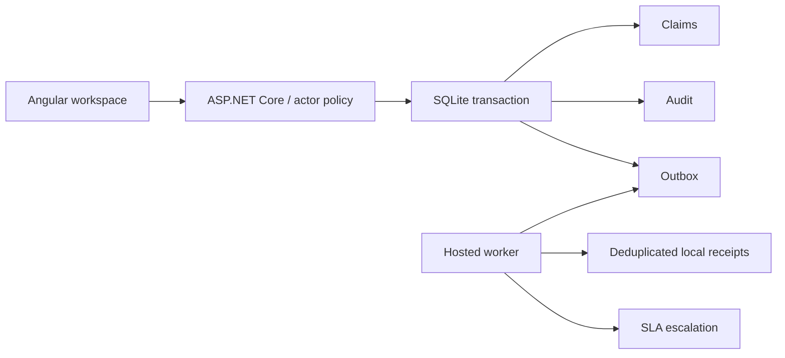
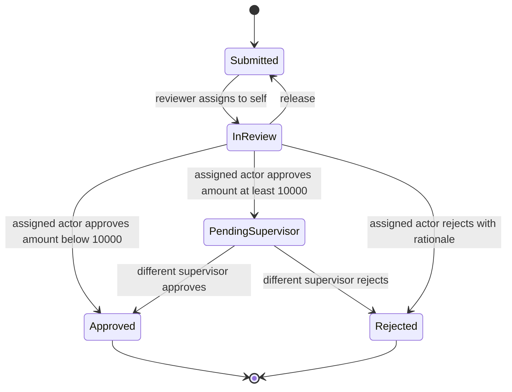

# Architecture and design decisions

## Scope

ClaimDesk models one claims operations team and synthetic USD claims. The application is a modular monolith: an Angular client, ASP.NET Core API, SQLite storage, and hosted background worker. Keeping these together makes transactional workflow guarantees explicit without introducing distributed deployment overhead.

## State machine and authority

Policy is enforced in the mutation transaction, not only in the UI. Supervisors may release another reviewer's assignment but cannot decide an InReview claim owned by someone else. A supervisor or administrator who performs the initial review cannot also perform the second approval. Every successful mutation increments the version. Final states reject further commands. All roles can submit and take intake claims; reviewer access to integration operations is forbidden.

## SQLite and concurrency

Schema version 1 creates claims, audit, idempotency, outbox, and integration_receipts tables plus indexes. Structured claim and audit data are stored as JSON documents inside relational tables; this reduces mapping overhead but sacrifices SQL querying and indexing of individual claim attributes. Reference uniqueness and receipt deduplication use database constraints.

Each write opens an immediate transaction; SQLite serializes writers across connections. The transaction reads the current version, validates ownership and transition, updates state, writes audit, and inserts an outbox record. Failure rolls back the entire unit. Two writers carrying version 2 cannot both commit a decision. The suite races eight independently constructed stores against the same file.

The version check is application-level optimistic concurrency protected by SQLite's write transaction. It is not a row-version token or a PostgreSQL compare-and-swap implementation. Changing databases requires retaining the equivalent atomic boundary.

## Request idempotency

Intake requires a client-generated key scoped to the actor. The normalized typed request is the fingerprint. A repeated key with the same input returns the original creation response, even if the case later changed. The same key with different input conflicts. A separate case-insensitive reference constraint catches duplicates across keys. Rejected requests do not persist idempotency entries. The UI keeps the key for uncertain network retries; after a confirmed creation it generates another.

Idempotency entries currently have no retention policy. The UI generates keys in memory: a browser reload loses an uncertain request key, though reference uniqueness still prevents duplicate claims. Persistent client retry queues would be a separate enhancement.

## Outbox and failure handling

Every workflow mutation creates an outbox event in the same transaction. The worker dispatches at most 50 events per five-second cycle. Failed attempts back off 2, 4, 8, 16, and 32 seconds; the fifth failure marks the record DeadLetter. A supervisor/admin can reset that record for replay. Failure simulation is configuration-based, never an arbitrary outbound URL.

The local sink inserts a durable integration_receipts row keyed by event ID and marks delivery in one SQLite transaction. This gives atomic deduplicated local delivery. It is not a demonstration of an external exactly-once network delivery guarantee. An external adapter would publish with the stable event ID, acknowledge only after success, and rely on an idempotent consumer for at-least-once redelivery after a crash.

## SLA processing

Normal cases receive 24 hours and urgent cases four hours at intake. Active overdue cases receive an escalation flag, incremented version, audit event, and outbox event once. Escalation does not force a decision or replace the workflow state. It invalidates stale reviewer commands intentionally. Deadline behavior is tested with explicit clock values instead of waiting in real time.

## Security and scaling boundaries

Service keys are compared using SHA-256 and constant-time byte comparison. A configured key maps to a fixed server-side actor and role. Client-supplied role headers do not grant authority. This is role authorization for service/demo identities, not individual human authentication. OIDC, organization membership, personal identities, separation-of-duties policy, and key lifecycle management remain required for real users.

Demo mode is opt-in; session creation only accepts loopback callers and same-origin requests. The HttpOnly SameSite=Strict cookie is for a local synthetic demonstration. Never expose demo mode through a reverse proxy or public tunnel. Demo sessions are in process memory and reset on restart.

SQLite on local disk is appropriate for the local demonstration. A server database, paging and indexed queries, integration transport, distributed scheduler coordination, telemetry export, load testing, backup automation, and production identity would be needed for wider deployment. There is no claim of a measured production throughput or availability SLO.
