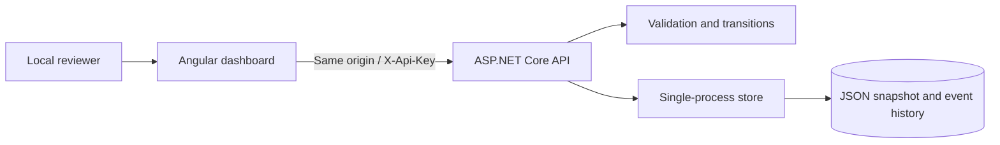

# Architecture and decisions

## Durable workflow

Each write holds one lock across uniqueness checks, transition validation, serialization, and replacement. A new dictionary is written to a temporary file in the same directory, then moved over the previous snapshot. Only after replacement succeeds does the in-memory state change. A write failure therefore does not publish an unpersisted transition to readers. The application refuses to start on malformed storage rather than silently resetting it.

Claims and history are persisted together. Exactly one competing decision succeeds within one process; later decisions receive 409. Restart and parallel-decision tests exercise those properties. Atomic replacement reduces partial-write exposure but does not promise power-loss durability: there is no explicit fsync or recovery journal.

## Why a JSON store?

It keeps the sample runnable without database provisioning while making persistence and concurrency behavior easy to inspect. It rewrites the dataset on every change and loads all records into memory. A real service should use a transactional database, a unique reference index, versioned updates, schema migrations, and tested recovery. A database transaction should commit both state and audit events. Do not run multiple instances against this file.

## API access

A startup check requires a configured secret of at least 24 characters. API requests compare SHA-256 digests using a constant-time comparison. This shared-secret approach has no individual identity, authorization roles, token expiry, or actor attribution. Production evolution: OIDC/OAuth tokens, policy-based reviewer permissions, and actor IDs recorded server-side.

## Browser boundary

The dashboard is served from the API origin. Angular escapes displayed values. No API key is committed, placed in URLs, or written to browser storage. A tab refresh clears the component key. A server error is displayed as text. No cross-origin access policy is enabled. The UI handles empty lists, network errors, duplicate submissions, and final-state conflicts, with responsive layout, field labels, keyboard-accessible controls, and a live status region.

## Production evolution

Priorities: transactional SQL persistence; authenticated roles; paging and query limits; idempotency; rate limits; structured telemetry; readiness checks; backup restoration drills; automated browser tests; and an HTTPS deployment with secret management. These are future work, not implemented capabilities.
